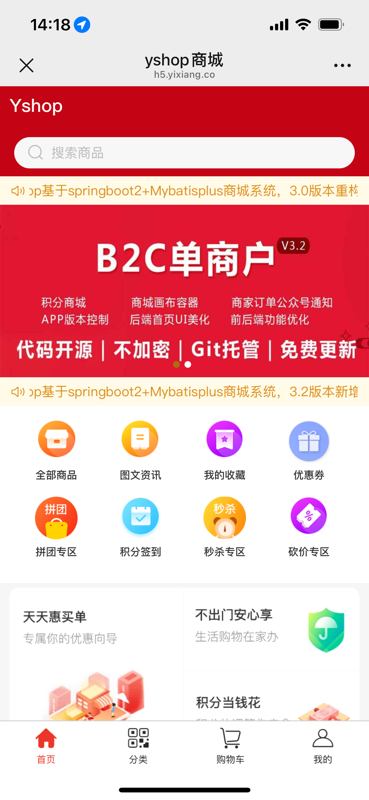
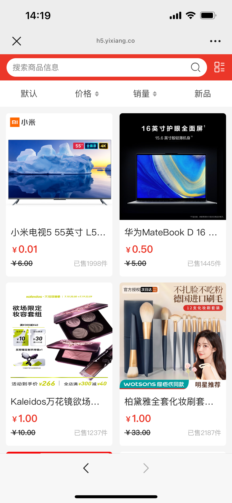
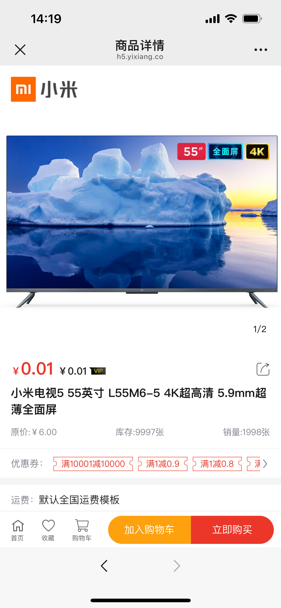
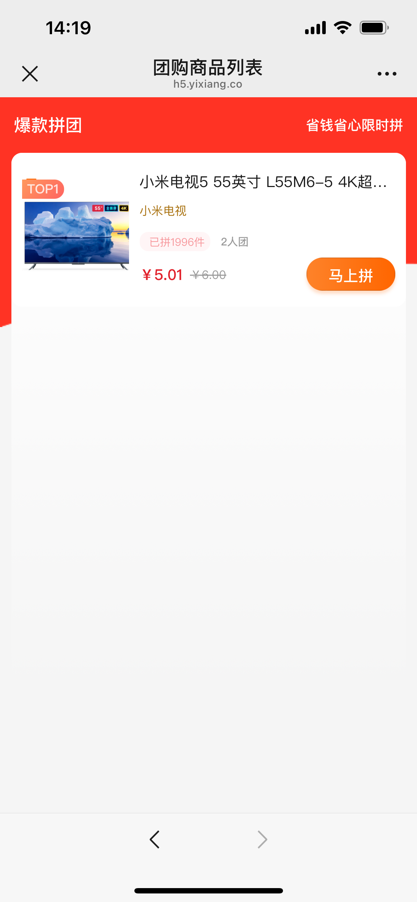
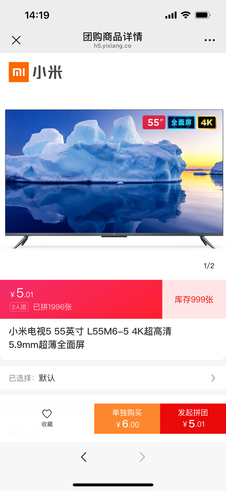
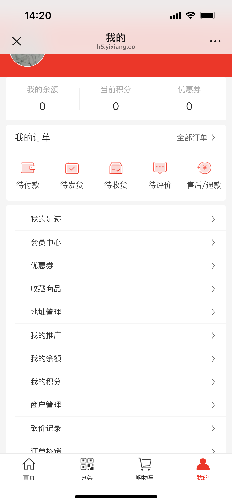

<h1 align="center">yshop 意象商城系统</h1>

<p align="center">
  前后端分离 · B2C 单商户 / B2B2C 多商户 · Spring Boot3 + Vue + uniapp
</p>

## 项目简介

yshop 基于当前主流技术栈的前后端分离商城系统，覆盖 **B2C（单商户）** 与 **B2B2C（多商户）** 两种商业模式：

- 后端：Spring Boot 3.4.3 + MyBatis-Plus + Spring Security + JWT + Redis
- 前端：Vue（管理后台）+ uniapp（小程序 / H5 / APP）

核心能力包括：商品与多规格、运费模板、素材库、拼团、快递、秒杀、优惠券、积分、分销、会员、充值、多租户等，适合企业或个人二次开发。

---

## 产品介绍与演示

### 多商户 B2B2C

YSHOP 多商户多店铺 B2B2C 电商系统，支持平台联营、招商入驻等运营模式，覆盖 **平台端 / 商家端 / 客户端**，并支持 PC、APP、小程序、H5 多终端。

能力概览：商家入驻审核、会员体系、商品/品牌管控、订单售后、平台活动（优惠券/秒杀/限时折扣）、分销渠道、种草、终端装修、风控财务、积分签到、场景营销等。

| 说明 | 链接 |
|------|------|
| 产品介绍与功能 | [https://www.yixiang.co/p/B2B2C.html](https://www.yixiang.co/p/B2B2C.html) |


### 单商户 B2C

单商户商城（Java 版）：一套代码多端适配（微信小程序 / H5 / APP），覆盖商品、支付、订单、拼团秒杀、会员积分、优惠券、首页装修、积分商城、分销、库存预警、多门店与同城配送（达达）等场景，适合品牌自营、同城零售、门店自提与连锁经营。

| 说明 | 链接 |
|------|------|
| 产品介绍、功能| [https://shanghongsys.com/singleV3.html](https://shanghongsys.com/singleV3.html) |


---

## 官网与交流

| 项目 | 内容 |
|------|------|
| 官网 | [https://www.yixiang.co](https://www.yixiang.co) |
| QQ 交流群 | 544263002（入群前请先 Star，群内有视频教程与开发文档） |
| 公众号体验移动端 |  |

如果本项目对你有帮助，欢迎点右上角 **Star** 支持，谢谢！

---

## 项目说明

```
- yshop-mall-boot     Java 后端工程
- yshop-mall-vue      后台前端工程
- yshop-mall-uniapp   uniapp 工程（小程序、H5、APP）
```

---

## 本地安装

### 基本环境（必备）

- JDK 17
- Redis 3.0+
- Maven 3.0+
- MySQL 5.7+
- Node v8+（建议 Node 10+）

### 开发工具

IntelliJ IDEA、HBuilderX、VS Code

### 后台系统工程（Java 端）

1. 请确保 Redis 已安装并启动  
2. 用 IDEA 打开 `yshop-mall-boot`  
3. 等待依赖加载完成  
4. 导入数据库，配置开发环境数据库与 Redis（路径示意如下）：


5. 在父级 `pom.xml` 执行 `mvn clean install`，或使用 IDEA 操作：


6. 启动程序

### 后台前端工程（Vue 端）

1. 确保已安装 Node（建议 Node 8 或 Node 10）  
2. 用 VS Code 打开 `yshop-mall-vue`  
3. 在工程目录执行 `cnpm install` 或 `yarn install`：


4. 执行 `npm run dev`，出现如下输出即表示启动成功：


5. 浏览器打开控制台打印的地址  

默认超管账号：`admin` / `123456`

### 移动端工程（uniapp 端）

1. 用 HBuilderX 打开 `yshop-mall-uniapp`  
2. 执行 `npm install`  
3. 直接运行即可  
4. 更详细教程可加入上方 QQ 群获取文档

---

## Nginx 线上部署

### 后台系统（Java 端）

1. `mvn install` 或用 IDEA 打成 jar 包  
2. 配置 Nginx（交流群群文件有视频教程）

### 后台前端工程（Vue 端）

1. 执行 `npm run build:prod` 编译打包  
2. 将打包后的 `dist` 上传到服务器  
3. 配置 Nginx（交流群群文件有视频教程）

---

## Docker 部署

1. 创建第三方软件服务目录：

```bash
mkdir -p /yshop/soft
```

2. 在该目录新建 `docker-compose.yml`：

```bash
vim /yshop/soft/docker-compose.yml
```

3. 创建挂载目录：

```bash
mkdir -p /yshop/mysql/data /yshop/redis/data /yshop/redis/conf
```

4. 创建 Redis 配置文件：

```bash
touch /yshop/redis/conf/redis.conf
```

5. Docker 部署细节参考根目录 `docker` 文件夹  

6. 先启动基础软件：

```bash
cd /yshop/soft
docker-compose up -d
docker ps -a
```

7. 再运行 `docker/application` 下的 compose（需先打包 jar、构建镜像）。在 Dockerfile 所在目录执行：

```bash
docker build -t yshop-admin .
```

---

## 商城功能

- **商品模块**：商品添加、规格设置、上下架等  
- **订单模块**：下单、购物车、支付、发货、收货、评价、退款等  
- **营销模块**：积分、优惠券、分销、拼团、秒杀、多门店等  
- **微信模块**：自定义菜单、自动回复、微信授权、图文管理、模板消息  
- **配置模块**：系统与业务各类配置  
- **用户模块**：登录、注册、会员卡、充值等  

### 系统预览

<table>
    <tr>
        <td></td>
        <td></td>
    </tr>
    <tr>
        <td></td>
        <td></td>
    </tr>
    <tr>
        <td></td>
        <td></td>
    </tr>
    <tr>
        <td></td>
        <td></td>
    </tr>
    <tr>
        <td></td>
        <td></td>
    </tr>
    <tr>
        <td></td>
        <td></td>
    </tr>
</table>

---

## 技术选型

### 后端

- Spring Boot 3.4.3  
- MyBatis / MyBatis-Plus  
- Spring Security  
- Druid  
- Slf4j  
- Fastjson  
- JWT  
- Redis  
- Quartz  
- MySQL  
- Swagger  
- WxJava  
- Lombok  
- Hutool  

### 前端

- Vue 全家桶  
- Element  
- uniapp  

---

## 反馈交流

喜欢这个商城的小伙伴，欢迎留下你的 **Star**！

## 使用须知

- 允许个人学习使用  
- 允许用于学习、毕设等  
- 允许商业使用，请自觉遵守使用协议  
- 请遵守 Apache License 2.0，再次开源请注明出处  

## 特别鸣谢

- [eladmin](https://github.com/elunez/eladmin)  
- [mybatis-plus](https://github.com/baomidou/mybatis-plus)  
- [hutool](https://github.com/looly/hutool)  
- [WxJava](https://github.com/Wechat-Group/WxJava)  
- [vue](https://github.com/vuejs/vue)  
- [element](https://github.com/ElemeFE/element)  
